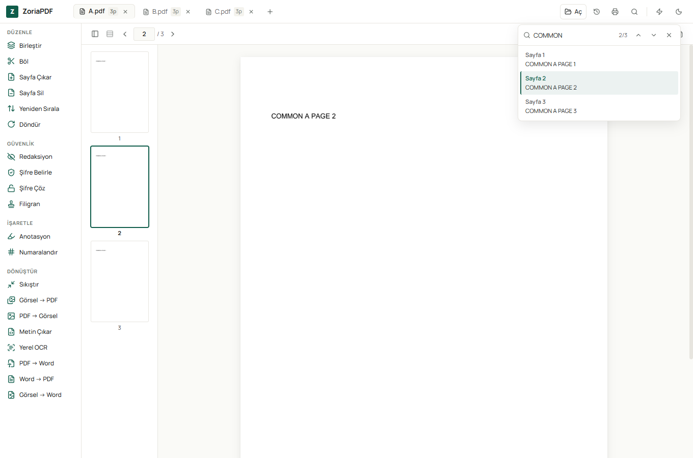

# ZoriaPDF for Windows

Offline PDF tools for Windows. Your documents are processed on your own computer and never uploaded.

**[Download the latest version](https://github.com/ZoriaSoft/zoriapdf-windows/releases/latest)** · [zoriapdf.com](https://www.zoriapdf.com/windows/)



## What it does

- **Read:** tabs, search, text inspection, printing
- **Edit pages:** merge, split, extract, delete, reorder, rotate
- **Protect:** permanent redaction, add or remove a password, watermark
- **Mark up:** highlight, text, drawing, signature, page numbers
- **Convert:** lossless compression, images ↔ PDF, text extraction
- **Word:** PDF → Word, Word → PDF, image → Word
- **OCR (offline):** Turkish and English text recognition for scanned pages, built into the installer

## Install

1. Download `ZoriaPDF-<version>-full-x64-setup.exe` from [Releases](https://github.com/ZoriaSoft/zoriapdf-windows/releases/latest).
2. Run the installer. Windows 10 or 11, 64-bit.
3. Compare the file with the SHA-256 checksum on the release page if you like:
   `Get-FileHash .\ZoriaPDF-1.1.3-full-x64-setup.exe`

The installer is signed with ZoriaSoft's own code-signing certificate, which Windows does not know yet. Windows SmartScreen may show "Windows protected your PC"; choose **More info → Run anyway** to continue.

## Privacy

- No account, no ads, no tracking.
- PDF processing and OCR run locally. The app does not send your documents anywhere.

## Türkçe

ZoriaPDF Windows sürümü: internet gerektirmeyen PDF araçları. Belgelerin bilgisayarında işlenir, hiçbir yere yüklenmez.

- Okuma, birleştirme, bölme, sayfa silme ve sıralama, döndürme
- Kalıcı karartma, parola koyma/kaldırma, filigran, imza
- PDF ↔ Word, görselden PDF, kayıpsız küçültme
- Türkçe ve İngilizce **çevrimdışı OCR** (kurulumun içinde gelir)

**İndir:** [Son sürüm](https://github.com/ZoriaSoft/zoriapdf-windows/releases/latest). Kurulum ZoriaSoft'un kendi sertifikasıyla imzalıdır; Windows ilk açılışta "Bilgisayarınız korundu" uyarısı gösterebilir. **Ek bilgi → Yine de çalıştır** ile devam edebilirsin.

## Building from source

Requires Rust (stable), Node.js 20+, and the Windows build tools.

```powershell
npm install
npm run native:fetch      # PDFium, Tesseract and models, checksum-verified
powershell -File scripts/build-windows.ps1 -Variant full
```

Output: `target/release/bundle/nsis/ZoriaPDF-<version>-full-x64-setup.exe`.

Built with Tauri 2, Rust and React. PDF engine: PDFium and lopdf. OCR: Tesseract. See [THIRD-PARTY-NOTICES.md](THIRD-PARTY-NOTICES.md).

## License

© 2026 ZoriaSoft. All rights reserved. The source is published for transparency; it is not licensed for redistribution. Third-party components keep their own licenses.
